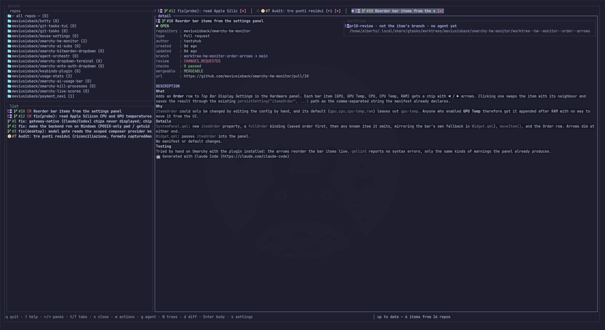

<div align="center">

# gtasks

**Your GitHub queue, worked from the terminal.** Multi-repo issues and PRs, review actions, git worktrees and agentic work — in a single Rust binary, next to your editor.

[](https://github.com/meviusisback/git-tasks-tui/actions/workflows/ci.yml)
[](https://github.com/meviusisback/git-tasks-tui/releases)
[](LICENSE)




*A shareable overview lives in [`docs/assets/promo-poster.png`](docs/assets/promo-poster.png) (editable source: [`docs/assets/promo.html`](docs/assets/promo.html)). The project site is <https://meviusisback.github.io/git-tasks-tui/>.*

</div>

## Why it exists

The loop is always the same: **read** the queue, **decide** what matters, **delegate** the work. gtasks keeps all three in one screen — no hopping between CLI and browser, no losing the thread while an agent runs. The TUI never suspends: agents stream into their own pane while you keep reading.

| Read | Decide | Delegate |
|---|---|---|
| One list across repos, search, closed history per repo | Side-by-side diff, checks, review state, red **CR** on PRs waiting on you | One key starts your agent on a fresh worktree — resume its session later |
| Tabs that survive filters, refreshes and restarts | Review actions (comment, approve, merge) without leaving the terminal | Five agents supported, sandboxed mode included |
| Bodies preload as you move, cached on disk | Worktree box names the tree, the agent, and the drift | New GitHub projects grown from inside the app (`N`) |

## Install (no build needed)

Download the latest release for your machine from
[Releases](https://github.com/meviusisback/git-tasks-tui/releases):

- **Linux**: `gtasks-linux-x86_64.tar.gz`
- **Mac** (Intel and Apple Silicon, one binary): `gtasks-macos-universal.dmg` —
  open it, copy `gtasks` somewhere on your `PATH`.

The DMG is unsigned (no paid Apple certificate): on first run macOS asks once —
right-click the binary, choose Open, confirm. Afterwards it starts normally.

## First run in three steps

```sh
gh auth login          # the only backend gtasks talks to
gtasks                 # repos pane first: R marks repos, Enter drills in
```

1. Press `R`, mark repos, `Enter` — the list fills from GraphQL and stays fresh from disk cache.
2. Move through the list while bodies preload. `d` shows the side-by-side diff, `m` offers review actions.
3. `g` starts your agent in its own worktree. `W` manages trees without the agent flow.

## Keymap (the daily dozen)

The full map lives in [`docs/keys.md`](docs/keys.md) — every row is taken from the key handler, and `?` shows it inside the app, icons included.

| Key | Does |
|---|---|
| `Enter` | Open a tab for the row (double-click works too); drill into a repo |
| `←` / `→` , `t` / `T` | Previous / next tab — the tab owns the detail and its agent |
| `d` | Side-by-side diff: old left, new right, changes in red/green |
| `g` | Agent + worktree for the item — offers the previous session back first |
| `W` | Worktrees directly, no agent flow |
| `N` | New GitHub project: name, visibility, branch → created, cloned, tree grown, agent menu |
| `a` / `m` | Review actions and merge (method × branch deletion is a choice) |
| `R` | Repo picker (re-reads GitHub on open) · `f` closed/open/all on one repo |
| `s` | Settings (sandboxed agents, terminal font) · `?` keys + icon legend |
| Mouse | Click focuses and selects, double-click opens, `[✕]` closes a tab, dividers drag, wheel scrolls |

Red **CR** after a PR number means *changes requested* — those rows are waiting on you.
The `◉` marker means a worktree already exists for that branch; if the tree drifted onto another branch, the box says so instead of going silent.

## Requirements

- Linux or macOS (Intel and Apple Silicon)
- [`gh`](https://cli.github.com/) installed and authenticated (`gh auth login`)
- A 256-colour terminal. The font settings (`s`) rewrite Foot's `font=` line,
  so they only take effect on Linux under Foot (restart the terminal).
- [Hermes Agent](https://hermes-agent.nousresearch.com/) (`hermes`) for agentic work;
  `pi`, `omp`, `opencode`, `agy` are picked up when installed
- Rust toolchain (`rustup default stable`)
- A Nerd Font for the icons (auto-detected, `GTASKS_NERD=1`/`0` overrides); without one the
  markers fall back to plain glyphs

## Build and run

```sh
cd ~/repo/git-tasks-tui
cargo run --locked          # dev, from the repo
cargo build --release       # ./target/release/gtasks
```

## Configuration (`~/.config/gtasks/config.toml`, mode 0600)

```toml
repos = ["owner/repo"]       # followed repos (or pick them with R)
clone_roots = ["/home/you/repo"]  # local clones, tried in order (no ~ expansion: absolute path)
worktree_root = null         # worktree base (default: $XDG_DATA_HOME/gtasks/worktrees)
agent_profile = "default"    # hermes -p profile for handoffs
sandbox_agents = false       # launch via <agent>-sandboxed wrappers
font_size = "Medium"         # Small | Medium | Large (whole terminal, Foot restart applies)
font_family = "monospace"    # whole-terminal typeface (Foot restart applies)
parallel = 4
timeout_s = 30
limit = 30
refresh_s = 300          # re-read the list every N seconds while idle (0 = off, min 10)
```

`state.json` (0600, atomic rename) holds what you picked — repos, filter, tabs, pane — so a restart resumes exactly where you left off.

## Docs

- [Keymap](docs/keys.md) — every key, what it does today
- [Agent CLI contract](docs/agent-cli.md) — how agents are launched (seed file, never argv)
- [Security](docs/security.md) — invariants, threat model, audit notes
- [Probes](docs/probes.md) · [Reviews](docs/REVIEWS.md) — verification trails

## Design rules

- **No shell, ever.** Every external command is an argv array; nothing user-supplied is re-parsed.
- **`gh` is the only backend**; the app never holds a token.
- **Worktrees live outside the clone** (configurable root, default `$XDG_DATA_HOME/gtasks/worktrees/`),
  resolved from the branch name, never re-derived after an outside rename.
- **The agent runs embedded** (pty, never suspends the UI) with `--ignore-rules` by default
  (repo-committed instruction files cannot steer it). YOLO-equivalents exist only inside the
  opt-in sandboxed launches — and only where the agent has one (omp; hermes keeps Smart).
- **Checked doors are declared.** Every `CheckedArgv` construction site is listed in
  `tests/invariants/lib.sh` with its reason — a new door is a decision, and CI refuses undeclared ones.
- **`config.toml` is hand-edited, `state.json` is not.**

## Contributing

```sh
cargo fmt --check && cargo clippy --locked --all-targets -- -D warnings
CARGO_BUILD_JOBS=4 sh scripts/test-all.sh   # suites ok / suites failed at the end
```

CI runs the same three steps on Linux and macOS. Pre-push hook: only `review/*`-tagged trees reach `main`.

## License

MIT — see [LICENSE](LICENSE).
