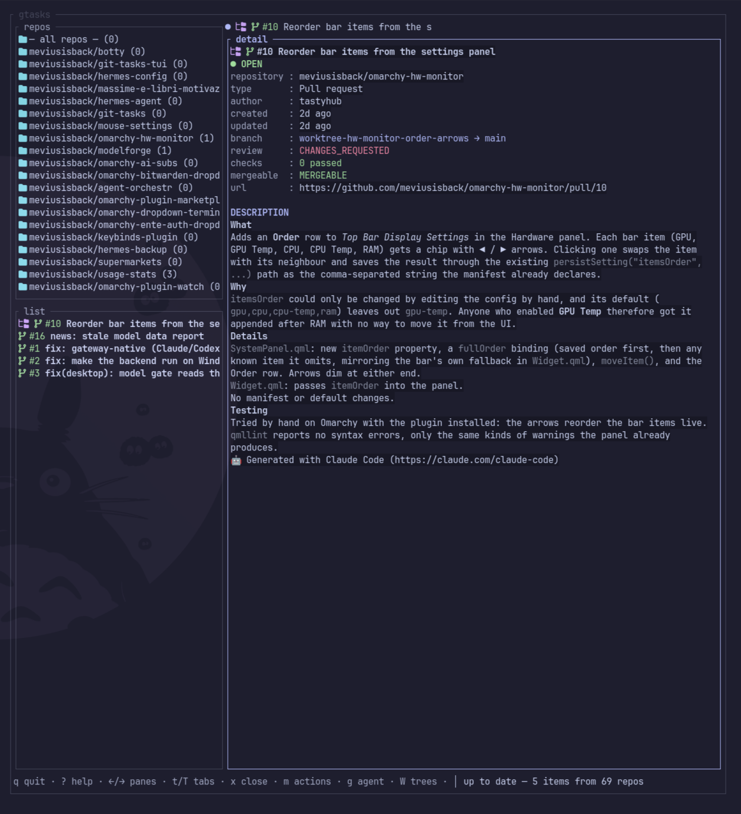

# git-tasks-tui

A terminal counterpart to the [git-tasks](https://github.com/meviusisback/git-tasks) Hermes Desktop plugin:
multi-repo GitHub issues and pull requests, detail view, review actions, git worktrees and agentic
work — in a single Rust binary.

The keymap is in [`docs/keys.md`](docs/keys.md); the agent contract in
[`docs/agent-cli.md`](docs/agent-cli.md); the security invariants in
[`docs/security.md`](docs/security.md).



A shareable overview lives in [`docs/assets/promo-poster.png`](docs/assets/promo-poster.png)
(editable source: [`docs/assets/promo.html`](docs/assets/promo.html)).

## What it does

- Follow repositories (`R` menu, saved to `state.json`); one list across repos with search.
- Tabs: `Enter` opens a tab per row, `t`/`T` cycle. Navigating tabs never reshapes the left column.
- Detail pane per item: state pill, meta table (author, branch, checks, review, …), separate
  `DESCRIPTION` section. Bodies preload as you move and are cached on disk (`details/`),
  revalidated in the background when `updated_at` changes; diffs fetch on `d`
  (once per item, then cached).
- Diff overlay on the selected PR (`d`): additions green, removals red, first 200 lines.
- Review actions without leaving the terminal: comment, approve, close/reopen, merge
  (merge/squash/rebase), branch deletion as a choice (`m` on the list, `a` for the first action).
- Git worktrees: pick an existing tree or name a new one from the PR (`g`, or `W` directly);
  grow a tree straight from the repo list (`W` on a repo, branch suggested, agent attached).
  Rename and delete from the same menu; a mauve marker flags rows, detail and tabs that
  already have a tree.
- Embedded agents in the bottom-right box (never suspends the TUI): hermes, pi, omp, opencode
  and agy — whichever binaries are installed. The seed travels as a `0600` file, rules from
  the repo are never inherited (`--ignore-rules`).
- Settings menu (`s`, saved to `config.toml`): sandboxed launches (`<agent>-sandboxed`
  wrappers; omp gets YOLO, hermes keeps Smart approvals, pi is containment-only) and the
  terminal font (size Small/Medium/Large, typeface from the installed monospace fonts —
  applied to Foot on restart).

## Requirements

- Linux
- [`gh`](https://cli.github.com/) installed and authenticated (`gh auth login`)
- [Hermes Agent](https://hermes-agent.nousresearch.com/) (`hermes`) for agentic work;
  `pi`, `omp`, `opencode`, `agy` are picked up when installed
- Rust toolchain (`rustup default stable`)
- A Nerd Font for the icons (auto-detected, `GTASKS_NERD=1`/`0` overrides); without one the
  markers fall back to plain glyphs

## Build and run

```sh
cd ~/repo/git-tasks-tui
cargo run --locked          # dev, from the repo
cargo build --release       # ./target/release/gtasks
```

## Configuration (`~/.config/gtasks/config.toml`, mode 0600)

```toml
repos = ["owner/repo"]       # followed repos (or pick them with R)
clone_roots = ["/home/you/repo"]  # local clones, tried in order (no ~ expansion: absolute path)
worktree_root = null         # worktree base (default: $XDG_DATA_HOME/gtasks/worktrees)
agent_profile = "default"    # hermes -p profile for handoffs
sandbox_agents = false       # launch via <agent>-sandboxed wrappers
font_size = "Medium"         # Small | Medium | Large (whole terminal, Foot restart applies)
font_family = "monospace"    # whole-terminal typeface (Foot restart applies)
parallel = 4
timeout_s = 30
limit = 30
refresh_s = 300          # re-read the list every N seconds while idle (0 = off, min 10)
```

## Design rules

- **No shell, ever.** Every external command is an argv array; nothing user-supplied is re-parsed.
- **`gh` is the only backend**; the app never holds a token.
- **Worktrees live outside the clone** (configurable root, default `$XDG_DATA_HOME/gtasks/worktrees/`),
  resolved from the branch name, never re-derived after an outside rename.
- **The agent runs embedded** (pty, never suspends the UI) with `--ignore-rules` by default
  (repo-committed instruction files cannot steer it). YOLO-equivalents exist only inside the
  opt-in sandboxed launches — and only where the agent has one (omp; hermes keeps Smart).
- **`config.toml` is hand-edited, `state.json` is not.** Repository picks change with one
  keypress, so the selection lives in the state file (0600, atomic rename) — never in the config
  a person edits by hand. Settings-menu toggles write both, each to its own file.

## License

MIT — see [LICENSE](LICENSE).
